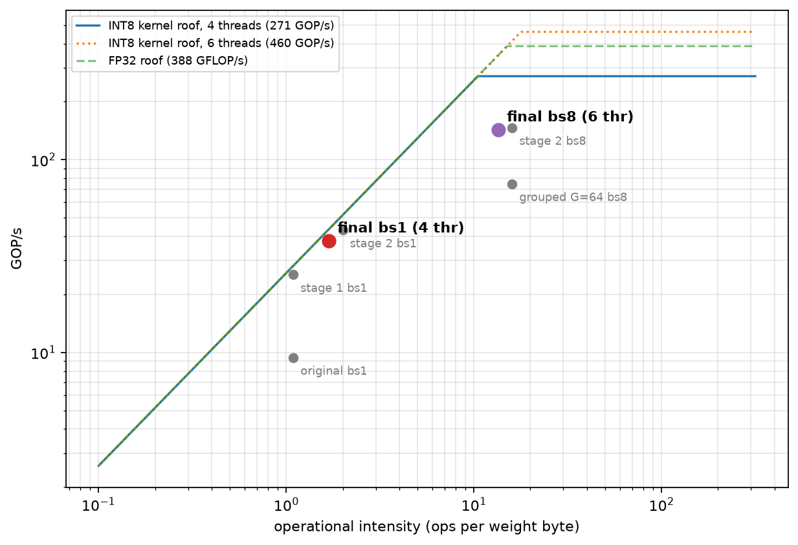

# Velox Inference Engine

A C++ inference engine for running Qwen2.5-style transformer models on CPU. It loads models directly from [safetensors](https://github.com/huggingface/safetensors) files, quantizes weights to INT8, and runs batched autoregressive generation with a growable KV cache - no PyTorch or Python runtime required at inference time.

## Techniques

- **Memory-mapped model loading** - [`safetensors.cpp`](src/safetensors.cpp) maps the model file directly into memory with [`mmap`](https://man7.org/linux/man-pages/man2/mmap.2.html) instead of reading it into a buffer. Tensors are read from the mapped region. F32 tensors are read in place; BF16 and F16 tensors are converted to FP32 once during loading (a temporary copy), quantized, and then the FP32 copies are freed and the file is unmapped.
- **Row-wise INT8 quantization (W8A8)** - Weights are quantized once at load time in [`ops::quantize_rowwise`](src/ops.cpp), with one scale factor per output row. Activations are quantized dynamically on every forward pass in [`ops::matmul_w8a8`](src/ops.cpp) with one scale per group of 64 channels (`ACT_GROUP`), so a single outlier channel cannot wipe out the precision of the whole row. The integer dot product is rescaled per group. The LM head is quantized too, which cuts the bytes streamed per decoded token roughly 4x compared to FP32 weights.
- **Grouped-query attention** - [`model.hpp`](include/model.hpp) configures fewer key/value heads (`num_key_value_heads`) than query heads (`num_attention_heads`), so multiple query heads share the same K/V projections. This shrinks the KV cache without changing attention quality much. See the [original GQA paper](https://arxiv.org/abs/2305.13245) for background.
- **Rotary position embeddings (RoPE)** - [`ops::rope`](src/ops.cpp) rotates query/key vectors by an angle derived from token position instead of adding a position vector. It encodes relative position directly into the attention dot product.
- **Amortized KV cache growth** - [`KVCache::ensure_capacity`](include/model.hpp) doubles the cache buffer whenever it runs out of room, the same growth strategy used internally by [`std::vector`](https://en.cppreference.com/w/cpp/container/vector). This keeps reallocation cost to `O(1)` amortized per token instead of resizing on every step.
- **Output-dimension parallel matmuls** - [`ops::matmul_w8a8`](src/ops.cpp) parallelizes over the output dimension `N` with the batch rows in the inner loop, so every weight row is streamed from memory once and reused for all sequences in the batch. (Parallelizing over the batch dimension left almost every core idle during decode.)
- **Conditional OpenMP parallelization** - attention loops use [`#pragma omp parallel for collapse(2)`](https://www.openmp.org/spec-html/5.0/openmpsu41.html), but only when `batch_size * num_heads` is large enough to justify thread spin-up. Small single-sequence workloads run single-threaded to avoid overhead.
- **BF16 to FP32 conversion via bit manipulation** - [`SafetensorsFile::bf16_to_float`](src/safetensors.cpp) reconstructs a float from a bfloat16 value by shifting its bits into the upper 16 bits of a 32-bit float, since BF16 is just a truncated FP32.
- **Byte-level BPE tokenizer without regex** - [`tokenizer.cpp`](src/tokenizer.cpp) implements Qwen2's pre-tokenizer split rules by hand (single digits, optional leading punctuation, Unicode letters and numbers via the generated tables in [`unicode_tables.hpp`](include/unicode_tables.hpp)) instead of using a regex engine, and maps special tokens such as `<|im_start|>` to their ids. It was fuzz-tested against the reference regex; check it against your own `tokenizer.json` with [`scripts/check_tokenizer.py`](scripts/check_tokenizer.py).
- **Non-owning tensor views** - [`Tensor::view`](include/tensor.hpp) and [`Tensor::row`](include/tensor.hpp) reinterpret existing memory with a new shape instead of copying data, similar to how NumPy views work.

## Notable Libraries & Technologies

- [OpenMP](https://www.openmp.org/) - compiler-level multithreading used for parallel loops across attention heads, quantization, and normalization.
- [safetensors](https://github.com/huggingface/safetensors) - the model file format this engine reads directly, designed for safe, fast, memory-mappable tensor storage.
- [nlohmann/json](https://github.com/nlohmann/json) (`json.hpp`) - parses `config.json` and `tokenizer.json` at load time.
- [Qwen2.5](https://huggingface.co/Qwen) - the model architecture this engine implements (grouped-query attention, RoPE, RMSNorm, SwiGLU MLP).
- [Hugging Face Transformers](https://huggingface.co/docs/transformers) - used only in [`scripts/verify.py`](scripts/verify.py) to generate reference logits for correctness checks against the C++ output.
- [CMake](https://cmake.org/) 3.16+ - build system, configured for `-O3 -march=native` release builds.

## Project Structure

```
.
├── CMakeLists.txt
├── README.md
├── include/
├── scripts/
└── src/
```

- [`include/`](include/) - public headers defining the model, tensor, tokenizer, sampler, and safetensors interfaces.
- [`src/`](src/) - implementation files, including the main inference loop and CLI entry point in [`main.cpp`](src/main.cpp).
- [`scripts/`](scripts/) - Python tooling for cross-checking output against Hugging Face `transformers`.

## Diagnostics

- `--tokenize-only` prints the prompt's token ids as a JSON list and exits without loading the model.
- `VELOX_PROF=1` prints a running average of forward-pass and LM-head time to stderr.
- `VELOX_DUMP_LOGITS=<file>` writes the first-step logits (single-sequence mode) in the format [`scripts/compare.py`](scripts/compare.py) reads.
- `VELOX_W8A32=1` runs the projections with FP32 activations (INT8 weights) to separate weight-quantization error from activation-quantization error.
- `VELOX_DEBUG_ACT=1` prints per-layer activation statistics for the prefill pass.

## Benchmarks

Qwen2.5-0.5B on an AMD Ryzen 5 220 (6 cores / 12 threads), 1-token prompt, 64 greedy-decoded tokens, mean ± std over the benchmark's repetitions. INT8 weights, INT8 activations in groups of 128, the 7 outlier-sensitive matrices in FP32 (load-time protection). `OMP_NUM_THREADS=6 OMP_PROC_BIND=close OMP_PLACES=cores`.

| Batch Size | TTFT (ms) | Per-Seq Speed (tok/s) | Aggregate Throughput (tok/s) |
|------------|-----------|-----------------------|------------------------------|
| 1          | 24±1      | 38.25±0.49            | 38.25±0.49                   |
| 2          | 26±1      | 36.93±0.12            | 73.86±0.25                   |
| 4          | 29±1      | 32.27±0.19            | 129.10±0.75                  |
| 8          | 51±5      | 18.03±0.80            | 144.21±6.43                  |

Batch-1 decode is memory-bound and gains nothing beyond about 4 threads; batch 8 is compute-bound and benefits from 6. Run-to-run and session-to-session variation on this laptop is roughly 5–10%.

### Optimisation history (decode, tok/s)

| Stage | Batch 1 | Batch 8 (aggregate) |
|-------|---------|---------------------|
| Original | 9.5 | 11.0 |
| Matmuls parallel over the output dimension | 25.6 | 128 |
| INT8 LM head (no activation groups, no protection) | 43.5 | 145 |
| + group-wise activation scales + FP32 protection (final) | 38.3 | 144 |

The last row is slower than the one above it at batch 1 on purpose: the earlier version produced wrong answers for single-token prompts (mean logit error about 1.2 versus about 0.14 now). Earlier rows are single 64-token runs, the last is the benchmark mean, so small differences between rows are within noise.

Resident memory after loading is about 1.3 GB, of which 0.55 GB is the FP32 embedding table.

### 
Measured on this machine: 25.8 GB/s read bandwidth (saturated by about 2 threads) and 271 GOP/s (4 threads) / 460 GOP/s (6 threads) for the autovectorised INT8 kernel. Batch-1 decode streams about 22 GB/s of weights, roughly 87% of the memory ceiling, so it is bandwidth-bound. Batch-8 decode reaches about 41% of its roof, so the INT8 kernel, not memory, is the limit there.

## Known limitations

- The batch-8 INT8 kernel reaches about 41% of its compute roof. A hand-written grouped kernel (VNNI intrinsics) is the obvious next step; the autovectoriser cannot produce one.
- Protecting whole matrices costs about 12% of batch-1 decode speed. Protecting only the outlier input columns would recover most of it.
- The embedding table is stored as FP32 (0.55 GB) alongside the INT8 LM head. Storing it as BF16 would halve it, exactly for BF16 checkpoints.
- Load-time protection calibrates with a single token (id 0) and assumes the first-token massive-activation pattern; disable with `VELOX_NO_AUTO_FP32=1`.
- Batching is static: sequences that finish early keep computing until the batch ends.
- Context is limited to 4096 tokens.
- The tokenizer matches Hugging Face on 25 test strings and a 100,000-string fuzz test against the reference regex (Unicode 15 tables); it has not been checked beyond that.