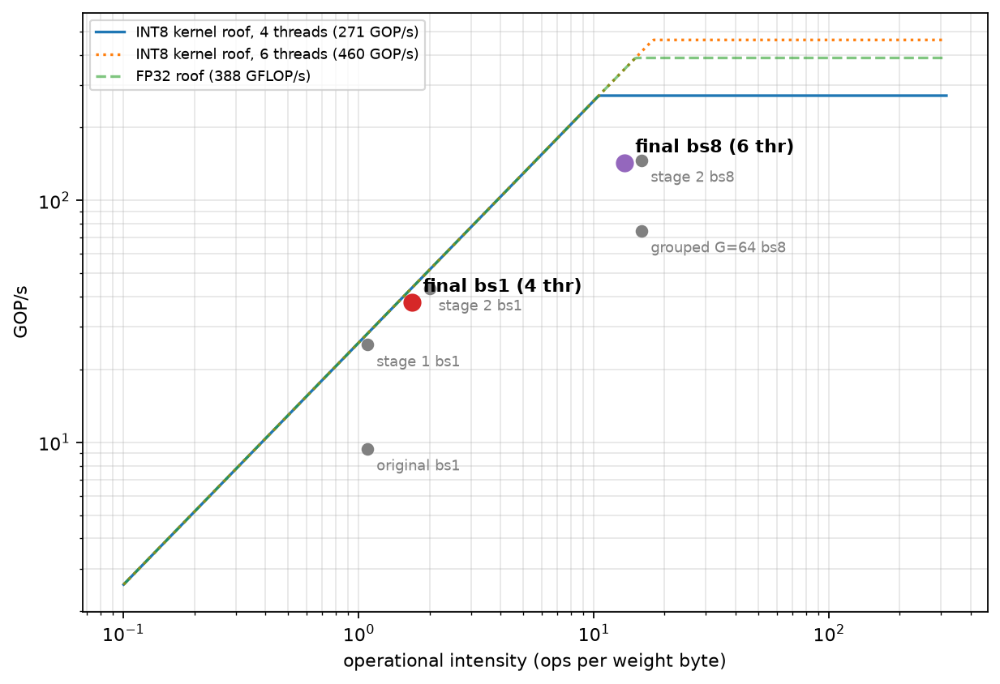

# Velox: results summary

## Decode performance (Qwen2.5-0.5B, Ryzen 5 220)
Batch-1 decode went from 9.5 to 38.3 tok/s (4.0×), batch-8 aggregate throughput from 11.0 to 144 tok/s (13×)

## Where decode time went
Originally the FP32 LM head was 81% of a batch-1 step (85 of 105 ms) and 92% of a batch-8 step. It ran on one thread, because the matmul parallelised over the batch rows. Parallelising over the output dimension and quantising the LM head to INT8 removed the bottleneck.

Final profile, batch 8 (4 threads): total 68.9 ms: lm_head 15.8, ffn_proj 43.1, qkv 3.7, o_proj 2.8, attention 2.0, ffn_act 1.05, everything else under 0.4. Parallelising silu/multiply cut ffn_act from 3.25 to 1.05 ms; the other buckets moved about 10% between sessions, which is machine variation.

Final profile, batch 1 (4 threads), average ms per decode step. Percentages are shares of the timed layer buckets:

| Component | ms | share of layers |
|---|---|---|
| ffn_proj (gate, up, down) | 16.28 | 81.3% |
| qkv_proj | 1.34 | 6.7% |
| o_proj | 1.24 | 6.2% |
| attention | 0.64 | 3.2% |
| ffn_act (silu, multiply) | 0.31 | 1.5% |
| rope + bias + KV append | 0.08 | 0.4% |
| input_norm | 0.06 | 0.3% |
| ffn_norm | 0.05 | 0.2% |
| **layers total** | **20.01** | |
| lm_head | 5.3 | |
| **forward total** | **25.3** | |

Both big consumers are close to the memory ceiling. Estimated from byte counts: the MLP streams about 405 MB per step (283 MB INT8 plus 122 MB for the seven protected FP32 matrices), which in 16.3 ms is about 25 GB/s, roughly 96% of the 25.8 GB/s read bandwidth. The INT8 LM head streams 136 MB in 5.3 ms, about 25.7 GB/s, which is at the ceiling. Batch-1 decode is bandwidth-bound, so further gains would need fewer bytes, not faster arithmetic.

### Roofline



```bash
g++ -O3 -march=native -fopenmp -o roofline_bench tools/roofline_bench.cpp -lm
OMP_NUM_THREADS=4 OMP_PROC_BIND=close OMP_PLACES=cores ./roofline_bench
```

Measured on this machine (raw output in [`docs/roofline.txt`](docs/roofline.txt)): read bandwidth peaks at 25.8 GB/s (median 23.9 GB/s at 4 threads; about 2 threads already saturate it), and the autovectorised INT8 kernel reaches 271 GOP/s at 4 threads and 460 GOP/s at 6 threads. Percentages below are relative to the peak bandwidth. Batch-1 decode streams about 22 GB/s of weights, roughly 87% of peak (94% of the median), so it is bandwidth-bound. Batch-8 decode reaches about 41% of its roof, so the INT8 kernel, not memory, is the limit there.

## Tokenizer (Unicode-aware test against Hugging Face)
74 test strings (hiragana, katakana, half-width katakana, full-width forms, common and rare kanji including CJK extension B, mixed Japanese/English, emoji with ZWJ, Cyrillic, Arabic, Greek, Hindi, special tokens): 71/74 identical token ids, round-trip decode 74/74. The 3 differences are deliberate probes of one gap: Hugging Face applies NFC normalisation and this tokenizer does not, so decomposed text (e + combining accent, kana + separate dakuten) differs. The evaluation corpora are already NFC (0 characters changed), and on them the token ids match Hugging Face exactly.

| Corpus | Chars | Bytes | Tokens | Tokens/char | Chars/token | Bytes/token |
|---|---:|---:|---:|---:|---:|---:|
| English (first 500k chars of WikiText-2 test) | 500,000 | 500,771 | 118,247 | 0.2365 | 4.23 | 4.24 |
| Japanese (293k-char file, whole) | 293,454 | 797,824 | 213,142 | 0.7263 | 1.38 | 3.74 |

Japanese needs 3.07x more tokens per character than English; per byte the two are close because a Japanese character is about 2.7 UTF-8 bytes.

## Perplexity (4 windows x 1024 tokens = first 4096 tokens of each corpus)

| Corpus | FP32 weights, FP32 KV | INT8 weights, FP32 KV | INT8 weights, INT8 KV |
|---|---:|---:|---:|
| English PPL | 14.182 | 14.309 (+0.9%) | 14.534 (+1.6% over the INT8-weights row) |
| Japanese PPL | 17.084 | 17.178 (+0.55%) | 17.971 (+4.6% over the INT8-weights row) |

Bits per byte (FP32 / INT8 weights): English 0.8881 / 0.8910, Japanese 1.0322 / 1.0342. Per-token perplexity is not comparable across the two languages. The INT8-KV figures use the final cache (key scale per 32 values); the same text with the initial per-head key scale gave 14.793 and 18.093 (+3.4% and +5.3%). The English result reproduces exactly across runs.

## llama.cpp baseline (same machine, same text, context 1024, 4 chunks, 6 threads, build 785322d)

| | English PPL | Japanese PPL | Delta English | Delta Japanese |
|---|---:|---:|---:|---:|
| F16 | 12.241 | 16.103 | | |
| Q8_0 weights | 12.270 | 16.151 | +0.24% | +0.30% |
| Q8_0 weights, Q8_0 KV cache (flash attention) | 12.350 | 16.294 | +0.65% | +0.88% |

Absolute values are not comparable with the table above (llama.cpp scores only the later part of each window and its own uncertainty is about +/-0.75 on English and +/-1.0 on Japanese); compare the relative changes. Quantising the weights costs more here (0.9% and 0.55%) than in llama.cpp (0.24% and 0.30%).

Decode speed, tokens/s (llama.cpp `llama-bench` tg64 at the given context depth; Velox is the median of 3 runs, INT8 weights, FP32 KV cache):

| Context depth | llama.cpp Q8_0 | llama.cpp F16 | Velox |
|---:|---:|---:|---:|
| 1024 | 41.4-41.8 | 24.0 | 35.5 |
| 2048 | 38.2-39.0 | 23.0-23.1 | 32.1 |
| 4096 | 32.6-33.7 | 21.3-21.4 | 26.8 |

Velox decodes about 15-19% slower than llama.cpp Q8_0 at these depths (ranges are the two runs, one per corpus). The Velox figures come from a different session than the earlier 34.7, 31.1 and 25.7 tok/s readings, which shows the session-to-session spread on this laptop.

## INT8 KV cache

Layout: INT8 values, keys with one float scale per 32 values, values with one scale per head, queries kept in FP32. 280 B per token per layer against 1024 B for FP32 (72.7% less). Long-context decode, INT8 weights, 128 timed decode steps after prefilling the stated context, median of 3 alternating runs (ranges in brackets):

| Context | KV memory FP32 / INT8 (MB) | FP32 KV tok/s | INT8 KV tok/s | INT8 / FP32 |
|---:|---:|---:|---:|---:|
| 1024 | 27.00 / 7.38 | 35.46 [35.31-35.49] | 35.00 [34.81-35.01] | 0.99x |
| 2048 | 51.00 / 13.95 | 32.05 [31.94-32.11] | 31.55 [31.55-31.57] | 0.98x |
| 4096 | 99.00 / 27.07 | 26.77 [26.68-26.81] | 26.28 [26.15-26.28] | 0.98x |

Memory is computed from the layout. The INT8 cache saves 72.7% of KV memory (72 MB at 4096 tokens) and is 1-2% slower, consistently outside the run-to-run range. On this model the cache is small (2 KV heads), so it does not pay off in speed: from 1k to 4k tokens a step takes 15 ms longer, while 3072 more positions of FP32 KV is only about 72 MB, or 2.8 ms at the measured 25.8 GB/s. Most of the long-context slowdown is attention compute, not KV traffic.

Which part of KV quantization costs accuracy (English, INT8 weights, FP32 cache with simulated quantization):

| Quantised | Scale group | PPL | vs 14.3092 |
|---|---:|---:|---:|
| none | | 14.3092 | |
| K and V | 64 (whole head) | 14.7573 | +3.1% |
| K only | 64 | 14.7684 | +3.2% |
| V only | 64 | 14.3012 | -0.06% |
| K and V | 32 | 14.5219 | +1.5% |
| K and V | 16 | 14.4934 | +1.3% |

Keys account for all of the loss and values are insensitive, so the real cache uses per-32 key scales and per-head value scales. A first version of the per-32 key loop took one horizontal reduction per group and ran at 0.53x of FP32 speed at 4096 tokens; accumulating both groups lane-wise with a single reduction restored 0.98x. Japanese improves less than English from the finer scale (+5.3% to +4.6%); the reason is not known. The remaining gap to llama.cpp's Q8_0 cache (+0.65% English) is partly a measurement difference (it scores only the later half of each window).

## Accuracy
Verified against Hugging Face on real weights: with everything in FP32 the engine matches to under 1e-3 mean logit difference. The INT8 error was concentrated at position 0, where "massive activations" (|x| ~ 1000) multiply INT8 weights in layer 2's down projection and layers 3 and 21's MLP. Keeping those 7 matrices in FP32 (detected automatically at load time) cut mean error on single-token prompts from 1.2 to about 0.14 and fixed top-1 flips, at -12% batch-1 speed.

## Fixes along the way
Heap overflows past 4096 tokens and on empty prompts, an out-of-bounds read in the long-context benchmark (needed ctx + steps + 1 tokens), tokenizer pre-tokenization (digits, Unicode, punctuation, special tokens, EOS), loader validation and F16 support, UTF-8 streaming, argument handling.

## Known limitations
See README.